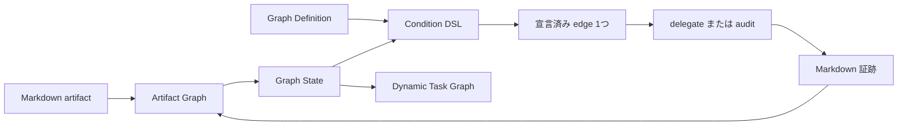

# Doc-Driven Dev APM Package

`doc-driven-dev-graph` はドキュメント駆動開発の公開 entrypoint です。正規
Markdown artifact を Graph State に投影し、選択した Graph Definition を評価して、
delegate または audit への宣言済みエッジを最大 1 つ、または明示的な terminal/blocked
結果を返します。人間向けの phase label
は語彙として利用できますが、実行の authority は Graph Definition です。

## 同梱内容

目的別の document skill と graph delegate を提供します。

- `idea-doc` は探索を文書化し、`deep-dive` は interview で意図を確認し、
  `briefing-flow` は探索を orchestrate します。
- `discovery-doc`、`adr-doc`、`spec-doc`: 意図と判断の記録。
- `design-doc` は durable な設計ベースラインを定義し、`plan-doc` と
  `task-doc` は Document Registry 3 の execution-bound レコードを扱います
  （`persistence: ephemeral` — creator は durable な Git 書き込みを拒否）。
- `verification-doc` は `docs/verification` に durable な検証証跡を記録し、
  `test-spec-doc` はレガシーの migration-only 形式です。
- `knowledge-doc` は `docs/knowledge` に durable な知識を記録します。
- `impl-doc` は、マイグレーションが読み取り reconcile するレガシーな
  Implementation Record / Experiment Log 形式を記述します。
- `doc-status`: document contract とリンクの audit（read-only）。
- [`doc-dashboard`](.apm/skills/doc-dashboard/SKILL.ja.md): ステータス別タスクカード、
  残存作業、draft 文書を表示するオフラインレポート。
- `doc-maintenance`: managed index 再生成を含む安全で決定的な修復の
  preview と apply。
- `implementation-flow`: 実装作業と review gate の委譲。
- `planning-flow`: Graph 委譲のための plan approval と task document の順序付け。
- `skill-discovery-protocol`: 利用可能な skill と adapter の発見。
- `doc-driven-dev-graph`: 1 エッジの routing と Task Graph の合成。

## Graph model

runtime は 4 つの明示的な layer で構成されます。

1. **Execution Graph** — `graphs/doc-driven-dev.yaml` が node、edge、
   condition、priority、delegate、audit を宣言する。
2. **Artifact Graph** — 正規 Markdown が ID、type、status、semantic relation
   を提供する。
3. **Graph State** — 各 route で Artifact Graph を投影し、focus、gate、signal、
   blocker、証跡を得る。
4. **Dynamic Task Graph** — focus された plan を planning / implementation 用の
   決定的な task dependency に投影する。



loop は `Graph Definition -> Graph State -> 宣言済み route 1つ ->
delegate/audit -> Markdown 証跡 -> 再投影` です。Definition にない遷移を phase
label から追加してはいけません。

### Condition DSL と priority

汎用 condition DSL は次を提供します。

- `signal`: caller または projection が宣言した signal を確認。
- `gate`: `pass` または `not-pass` の named gate を確認。
- `task-graph`: task projection の `active`、`runnable`、`invalid`、`idle` を確認。

current node の eligible edge は昇順の `priority`、次に安定した edge ID で並べ、
最初の 1 つだけ返します。terminal は idempotent な結果、blocked は fail-closed な
結果であり、遷移先を推測しません。`tasks-active` は `tasks-runnable` より優先され、
新規作業を始める前に eligible な active work を再開します。

### Delegate と subgraph

binding は Graph Definition に宣言されています。

- migration: `migrate_docs`; bootstrap: `scaffold_docs`。
- briefing: `briefing-flow`; design: `design-doc`。
- planning: `planning-flow`。`plan-doc` の approval 後に `test-spec-doc`、続いて
  `task-doc` を順序付けます。
- task projection: `build_task_graph`。`plan`/`task`/`test-spec` audit 後に
  `build_task_graph.js` が実行します。
- implementation: `implementation-flow`; exit audit: `doc-status`。

委譲された skill が briefing / planning / implementation subgraph を担当します。
caller は返された audit をすべて実行してから、返された delegate だけを dispatch
します。
`focus-required` は明示的 focus が渡されるまで hard stop です。

### Task Graph invariant

選択された Execution Store run の plan と task record が authority です —
graph は `(runId, taskId)` を基準に、ちょうど 1 つの run の read-only
projection です。record の `dependsOn` が同一 run 内の兄弟 task 間の有向
edge になります。run の `plan.md` が digest-bound な承認を持ち、全
predecessor が `done` のときだけ task は runnable であり、`wont-do` は
dependency を満たしません。ID の重複、未解決参照、cycle、壊れた record、
plan の欠落・未承認、plan digest のずれ、空の task 集合は issue と空の
runnable 集合になります。corpus の `docs/tasks/` Markdown は履歴であり、
参照されません。

### Persistence boundary

durable な Markdown が project history と status の authority であり、
`plan` と `task` は durable な Git の形を持たない execution-bound です。
run ごとの実行状態は Git 管理外の Execution Store
（`.apm/state/doc-driven-dev/runs/`）に保持します。Graph State と Dynamic
Task Graph は現在の turn の projection であり、runtime は並行する
lifecycle database を作成せず、要求もしません。

## インストール

APM からインストールします。

```bash
apm install doc-driven-dev
```

配布 asset は `.apm/skills/` にあります。この repository の source と test は
`scripts/doc-driven-dev/` にあります。

## 検証

repository root から実行します。

```bash
pnpm --dir scripts/doc-driven-dev test
pnpm --dir scripts/doc-driven-dev run lint:md
```

consumer repository で route を確認するには次を使います。

```bash
node .apm/skills/doc-driven-dev-graph/scripts/route_graph.js \
  [--graph <path>] [--current <node>] [--signal <condition-signal>] \
  [--focus <artifact>] [--task-dir <path>] [--cwd <path>] --json
```

## 共通 relation

front matter relation で document graph を保持します。Knowledge Relations
v1 では durable 文書は次の source→target relation を記録します。

- `source`: discovery / research の証跡（provenance。全 durable 種別で可）。
- `motivates`: idea、brainstorm、discovery が動機付ける spec または ADR。
- `informs` / `explains`: discovery・knowledge 文書が情報提供・説明する
  durable 文書。
- `decides-for`: ADR が決定する spec または design。
- `realizes`: design が実現する spec。
- `supersedes`: 同種の旧文書を置き換える。

逆方向ビュー（`superseded-by`、`implemented-by` など）は通常は導出される
もので保存しません。ただし `relate_adr` は #235 で語彙が絞り込まれる
まで宣言済みペアの双方向を書き込みます。`implements`、`derives-from`、
`references`、`verifies`、`defers` などその他の宣言 relation キーは
レガシー語彙で、マイグレーションは v3 以前のコーパスから読み取ります。
creator は空のプレースホルダーとしてのみ出力しますが、`relate_adr` と
`new_design --from` は同じ絞り込みが完了するまで設定できます。
（`relations.changes` と `relations.test-spec-skip` はリンクではなく
メタデータペイロードです。）

file 名や directory の近さから ownership を推測しないでください。canonical ID
と relation を使い、事実が衝突したら focus 解決を fail closed にします。

## Graph runtime command

`route_graph.js` は 1 turn を実行します。

1. Graph Definition と current node を選ぶ。
2. 正規 Markdown を Graph State に投影する。
3. focus、gate、signal、blocker を評価する。
4. condition DSL と priority 順を評価する。
5. edge 1 つ、terminal、または blocked を返す。
6. required audit を実行し、delegate を dispatch して Markdown 証跡を記録する。
7. 再投影して `next` から再入力する。

公開 skill は完全な 10 ステップ loop と GraphRoute JSON contract を説明します。
schema と gate の詳細は次を参照してください。

- `.apm/skills/doc-driven-dev-graph/references/graph-contract.ja.md`
- `.apm/skills/doc-driven-dev-graph/references/graph-state.ja.md`
- `.apm/skills/doc-driven-dev-graph/references/execution-contract.ja.md`
- `.apm/skills/doc-driven-dev-graph/references/task-graph-contract.ja.md`

## 既存 docs の migration

migration スクリプトは `doc-maintenance` が所有します（同じコマンドは
`doc-driven-dev-graph/scripts/` 配下の互換エントリポイント経由でも
実行できます）。適用前に preview します。

```bash
node .apm/skills/doc-maintenance/scripts/migrate_docs.js --from docs --json
```

preview を確認してから適用します。

```bash
node .apm/skills/doc-maintenance/scripts/migrate_docs.js \
  --from docs --split-h1 --apply
```

不足している canonical tree は `scaffold_docs.js` で bootstrap し、生成された
証跡を `doc-status` で audit してください。

## Dashboard

Graph の状態、ステータス別のタスクカード、残存タスク、draft 文書を手動生成する
オフライン HTML で確認するには、[doc-dashboard](.apm/skills/doc-dashboard/SKILL.ja.md)
を使います。生成されたボードは read-only snapshot で、canonical Markdown と Graph
YAML が authority です。
